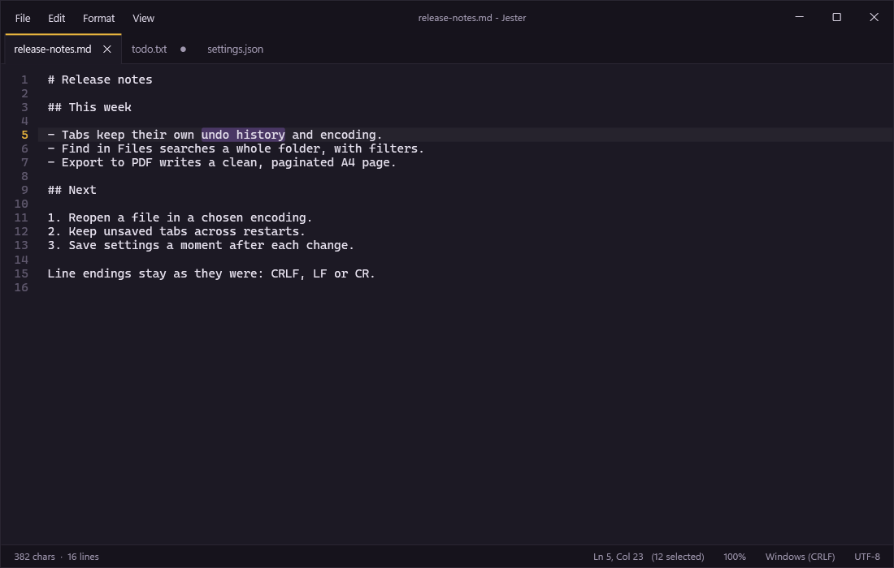

<div align="center">


# Jester

A fast notepad for Windows, in purple and gold.

[](https://github.com/dominikkoenitzer/Jester/actions/workflows/ci.yml)



</div>

## Download

[Download Jester](https://jester.punds.ch), then double-click it.

It's a single portable file. No installer, and no .NET install required, since the runtime is bundled. Works on Windows 10 and 11 (64-bit).

If Windows shows "Windows protected your PC", click More info, then Run anyway. It shows because the build is unsigned.

## Features

- Tabs, each with its own undo history and encoding. Close one with `Ctrl+W` or a middle-click, switch with `Ctrl+Tab`.
- Line numbers in a gutter you can hide from View, with the current line highlighted in the gutter and the editor.
- Find and replace in a panel over the text, with Replace All, match case and wrap-around. Enter finds the next match, Shift+Enter the previous one.
- Find in Files (`Ctrl+Shift+F`) searches a whole folder, with file filters and subfolders; double-click a result to jump straight to it.
- Open several files at once, reopen one from Open Recent, drop files on the editor, or open a file with Jester from Explorer.
- Export to PDF (`Ctrl+Shift+E`) turns the current tab into a clean, paginated A4 PDF.
- Go To Line, the time and date in your own short formats, auto-indent, and unlimited undo and redo.
- Format: word wrap, a font picker, and converting the line endings or the encoding.
- Zoom from the View menu or with `Ctrl` and the mouse wheel.
- A status bar you can hide, with characters, lines, caret position, zoom, line ending and encoding.
- A dark and a light theme that follow the Windows app mode and switch as soon as it changes.
- Your window, tabs and preferences come back on the next launch. Unsaved and Untitled tabs are kept as you type and return with their text, even after a crash or shutdown.
- Saves are atomic, so a crash can't corrupt your file.
- Files with a UTF-8 or UTF-16 byte-order mark open in that encoding, other files as UTF-8 when they are valid UTF-8 and in the ANSI code page when not, and every file is saved back in its own encoding and line endings. File > Reopen with Encoding reads a file again in the encoding you pick.

## Keyboard shortcuts

| Action | Shortcut | Action | Shortcut |
| --- | --- | --- | --- |
| New Tab | `Ctrl+N` | Find | `Ctrl+F` |
| Open | `Ctrl+O` | Find Next / Previous | `F3` / `Shift+F3` |
| Save | `Ctrl+S` | Replace | `Ctrl+H` |
| Save As | `Ctrl+Shift+S` | Find in Files | `Ctrl+Shift+F` |
| Save All | `Ctrl+Alt+S` | Go To Line | `Ctrl+G` |
| Close Tab | `Ctrl+W` | Time/Date | `F5` |
| Next / Prev Tab | `Ctrl+Tab` / `Ctrl+Shift+Tab` | Zoom In / Out | `Ctrl++` / `Ctrl+-` |
| Export to PDF | `Ctrl+Shift+E` | Restore Zoom | `Ctrl+0` |
| Exit | `Ctrl+Q` | Undo / Redo | `Ctrl+Z` / `Ctrl+Y` |
| Select All | `Ctrl+A` | | |

## Your data, updates and removal

Jester keeps everything it remembers in `%APPDATA%\Jester`:

- `settings.json`: font, zoom, word wrap and the other Format and View choices, the window's size and position, and the recent and open files.
- `sessions\`: one `.json` file per window with its tabs, including the text of unsaved and Untitled tabs, plus a `.lock` file while that window is open.
- `crash.log`: only there if Jester ever hit an unexpected error.

To update, download the new Jester.exe and put it in place of the old one. Your settings and session stay, since they live in that folder and not next to the exe.

To remove Jester, close every Jester window, then delete Jester.exe and the `%APPDATA%\Jester` folder. That also deletes the text of unsaved tabs, so save anything you want to keep first.

## Build from source

You need Git and the [.NET 10 SDK](https://dotnet.microsoft.com/download) on Windows. On a fresh PC, install both with winget:

```powershell
winget install --id Git.Git --exact
winget install --id Microsoft.DotNet.SDK.10 --exact
```

Then open a new terminal, so it picks up the new PATH, and run:

```powershell
git clone https://github.com/dominikkoenitzer/Jester.git
cd Jester
dotnet run -c Release
```

Produce the portable single-file build that ships in releases:

```powershell
dotnet publish Jester.csproj -c Release -r win-x64 --self-contained true -p:PublishSingleFile=true -p:IncludeNativeLibrariesForSelfExtract=true -p:EnableCompressionInSingleFile=true
```

The executable lands in `bin/Release/net10.0-windows/win-x64/publish/Jester.exe`.

### Tests

```sh
dotnet test Jester.sln
```

260 xunit tests cover the parts that work without a window: find/replace,
settings persistence, the command table, file encodings and line endings, the
session that keeps unsaved tabs, the line index behind the status bar, and the
editor's own edits, gutter and current-line highlight, laid out with no window.
The rest of the WPF views are verified by running the app. CI runs the same
command.

```sh
dotnet run -c Release --project tests/Jester.Bench
```

times what a keystroke costs the status bar and the gutter in 1, 5 and 20 MB
documents. It is not part of the solution, so CI leaves it out.

## Project structure

| Path | Purpose |
| --- | --- |
| `App.xaml(.cs)` | Application entry point, session-end and crash handling. |
| `MainWindow.xaml(.cs)` | The main window: fields, command bindings, settings/session, shutdown. |
| `MainWindow.Tabs.cs` | Creating, switching and closing document tabs. |
| `MainWindow.Files.cs` | Open, save, reopen with an encoding, PDF export and the recent-files list. |
| `MainWindow.Search.cs` | Find, replace, find-in-files and go-to-line. |
| `MainWindow.View.cs` | Word wrap, line numbers, font, encoding, line endings, zoom. |
| `MainWindow.Editing.cs` | Auto-indent, the time/date stamp, ctrl-wheel zoom, drag and drop. |
| `MainWindow.Session.cs` | Keeping every tab, saved or not, across restarts and crashes. |
| `MainWindow.Status.cs` | Title bar and status bar updates. |
| `SessionState.cs` | What the session keeps of each tab and how stored sessions come back. |
| `SessionStore.cs` | One session file per window, with its lock file. |
| `FileOps.cs` | The file calls behind every save: the temp file and the replace or move that puts it in place. |
| `EditorView.cs` | One document's editor surface (AvalonEdit editor + gutter + current-line highlight). |
| `LineNumberMargin.cs` | The line-number gutter drawn beside each editor. |
| `LineIndex.cs` | Line lookups and the line ending, kept per edit for the status bar and gutter. |
| `DocumentTab.cs` | Per-tab document state (path, encoding, dirty flag). |
| `TextSearch.cs` | Find/replace arithmetic, with no editor attached. |
| `FindResult.cs` | One Find in Files match. |
| `AppSettings.cs` | Loads and saves preferences as JSON. |
| `ThemedWindow.cs` | Base window with the custom title bar: the menu, the title and the caption buttons in one row. |
| `Theme.xaml` | Control styles, drawn from the active palette. |
| `Themes/Dark.xaml`, `Themes/Light.xaml` | The two palettes in purple and gold. |
| `ThemeManager.cs` | Picks the palette that matches the Windows app mode and swaps it when that changes. |
| `FindPanel.xaml(.cs)` | Find and replace, over the top right of the editor. |
| `JesterCommands.cs` | Custom routed commands and key gestures. |
| `PdfExporter.cs` | Renders the document to PDF (QuestPDF). |
| `FindInFilesWindow`, `GoToWindow`, `FontWindow` | Dialogs. |
| `Assets/` | The application icon and the logo. |
| `tests/Jester.Tests/` | xunit suite. |
| `tests/Jester.Bench/` | Per-keystroke timings on large documents. |

## Contributing

Contributions are welcome. Please read [CONTRIBUTING.md](CONTRIBUTING.md), and open an issue if you find a bug or have an idea. Report security issues privately, as [SECURITY.md](SECURITY.md) describes.

## License

Jester is free software licensed under the [GNU GPL v3.0](LICENSE).
Copyright © 2026 Jester.

## Author

Built and written by [@dominikkoenitzer](https://github.com/dominikkoenitzer).
